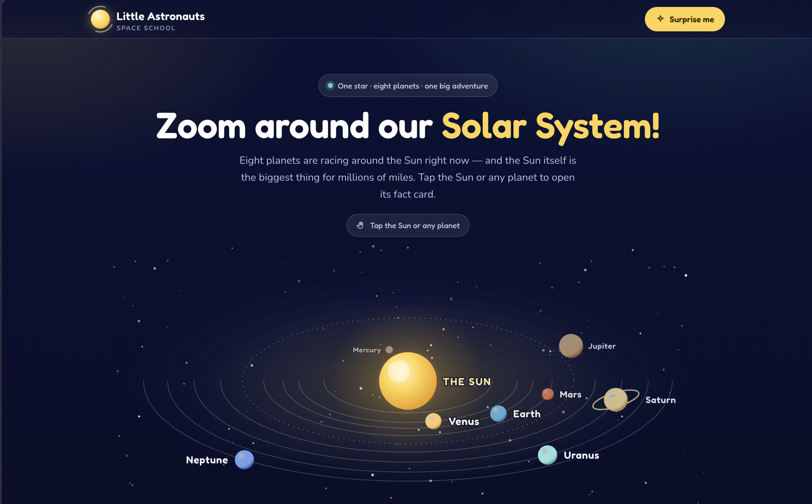

# Little Astronauts — a Solar System for Kids

An interactive, single-page website that lets children watch the eight planets orbit the Sun in a
tilted 3D scene, then tap any of them to open a friendly fact card. Everything — layout, animation,
illustrations and copy — lives in one self-contained `index.html` with no build step, no image files
and no JavaScript libraries.

> **Created using Indus by Sarvam AI.**

---

## What it is

The page opens on a live solar system. The orbital plane is drawn at a slant, so planets on the far
side of the Sun shrink, dim and pass behind it, while planets on the near side grow and pass in
front. Each orbit is split into a faint dashed back half and a brighter solid front half, which makes
the tilt readable even when a planet is hidden.

Tapping the Sun or any planet opens a pop-up card with the object's nickname ("The Ringed Wonder",
"Our Own Star"), a short introduction written to be read aloud, six fact tiles in plain language
(how wide, one day, one year, moons, heat, distance), a "Did you know?" highlight, and a link to that
object's own page on NASA's website.

The content is aimed at roughly ages 6–11: short sentences, comparisons instead of bare numbers
("hot enough to melt lead", "109 Earths side by side"), and no jargon left unexplained.

---

## Features

| Feature | Detail |
| --- | --- |
| 3D orbital scene | Tilted elliptical orbits with depth sorting — planets pass in front of and behind the Sun |
| Nine fact cards | The Sun plus all eight planets, each with six facts and a "Did you know?" |
| Pop-up dialogs | Native `<dialog>` elements: modal, focus-trapped, closable with Esc or a tap outside |
| Speed control | Slow / Normal / Fast, plus a Pause button that becomes Play |
| Surprise me | Opens a random card from the header |
| Planet picker | A row of large cards below the scene, so nothing depends on catching a moving dot |
| Deep links | `index.html#saturn` opens Saturn's card directly |
| Accessible | Full keyboard support, visible focus rings, `prefers-reduced-motion` respected |
| Self-contained | One file, ~103 KB, no images, no JS dependencies |

---

## How to use it

1. Download `index.html`.
2. Double-click it, or drag it into any browser. That is the whole install.

To publish it, upload the single file to any static host — GitHub Pages, Netlify, an S3 bucket, a
school web server. No server-side code is involved.

The only external request is the Google Fonts stylesheet for **Fredoka** and **Nunito**. Offline, the
page falls back to system fonts and everything else still works.

**Browser support:** any current version of Chrome, Edge, Firefox or Safari. The fact cards use the
native `<dialog>` element, which needs a browser from 2022 or later.

---

## File structure

```
index.html    the entire site — markup, styles, animation and content
README.md     this file
```

---

## Customising it

Everything is in `index.html`, in four places:

- **Colours and type** — the `:root` block at the top of the `<style>` section. `--bg`, `--sun`,
  `--coral`, `--mint` and the two font stacks control the whole palette.
- **Fact card text** — search for `id="dlg-saturn"` (or any planet name) and edit the plain HTML
  inside. The six tiles are the `.fact` blocks; the highlight is the `.wow` block.
- **Orbit size and speed** — each planet in the scene is a `<g class="pl">` with two attributes:
  `data-rx` is its distance from the Sun (in scene units) and `data-per` is how many seconds one lap
  takes. Bigger `data-per` means a slower planet.
- **Planet colours** — each planet's two colours are set in its gradient (`#dot-saturn`,
  `#pg-saturn`) and on the picker card's `--pa` / `--pa2` custom properties.

---

## The prompt that generates this page

Paste the following into Indus by Sarvam AI to produce a page like this one. It is written to be
self-contained — it assumes no earlier conversation and no supplied assets.

```text
Build a single-page website for children aged 6 to 11 to learn about the solar system. Everything
must live in one self-contained index.html file: no build step, no image files, no JavaScript
libraries. The only external request may be a Google Fonts stylesheet.

THE SCENE
- Show the Sun at the centre with all eight planets orbiting it continuously, animated with
  requestAnimationFrame.
- Make it look three-dimensional: draw the orbital plane tilted, so each orbit is a wide ellipse
  rather than a circle. Planets on the far side of the Sun must shrink, dim and pass behind it;
  planets on the near side must grow and pass in front. Split each orbit ring into a faint dashed
  back half and a brighter solid front half so the tilt reads clearly.
- Draw each planet as a lit sphere with an SVG radial gradient: a highlight at the upper left, a
  terminator falling off to the lower right, and a rim of light on the dark edge. Saturn gets rings
  that pass both behind and in front of the planet body; Jupiter and Saturn get banding.
- Add a starfield, a faint asteroid belt between Mars and Jupiter, and a soft glow under the Sun.
- Label every planet with its name, placed outward from the Sun so labels never cross it, with a
  dark halo so they stay readable over the orbit lines. Include a "The Sun" label beside the disc,
  drawn above the planets so nothing ever covers it.

THE INTERACTION
- Clicking the Sun or any planet opens a pop-up fact card for that object. Use native <dialog>
  elements with showModal(), one per object, so focus trapping and the Escape key work for free.
  Also close when the backdrop is clicked.
- Each card contains: a large 3D illustration, the object's name, a friendly nickname such as
  "The Ringed Wonder" or "Our Own Star", a short introduction written to be read aloud, six fact
  tiles (how wide, one day, one year, moons, heat, distance) each with a plain-language note
  underneath, a "Did you know?" highlight, previous and next buttons that walk the sequence from
  the Sun outward, and a link to that object's own page on NASA's website
  (https://science.nasa.gov/<name>/) opening in a new tab.
- Pause the orbits while the pointer is over the scene, so a moving planet is easy to catch.
- Add Slow / Normal / Fast speed buttons and a Pause button that switches to Play.
- Add a "Surprise me" button that opens a random card.
- Below the scene, add a row of large tappable cards, one per object, as an alternative way in —
  the scene is small on a phone.
- Support deep links: index.html#saturn opens Saturn's card on load.

WRITING STYLE
- Aim at ages 6 to 11. Short sentences, second person, no unexplained jargon.
- Give comparisons instead of bare numbers: "109 Earths side by side", "hot enough to melt lead",
  "would float in a bathtub". Keep the real figures in the fact tiles as well.
- Facts must be accurate and sourced from NASA's planet pages. Credit NASA in the footer with a
  real hyperlink.

DESIGN
- Playful and bright, not corporate. Rounded Fredoka headings over Nunito body text, chunky 24px
  corner radii, generous tap targets of at least 44px, and a deep navy space background with a
  twinkling starfield.
- One clear accent per planet, used consistently in the scene, the card and the picker.
- Accessible: visible focus rings, semantic headings, aria-labels on the scene links, and full
  respect for prefers-reduced-motion (render the planets still, drop the entrance animations).
- Responsive from 360px phones to wide desktops. On small screens the card facts become two
  columns and the picker becomes one column.
```

---

## Facts and sources

Every figure on the cards comes from NASA's planet fact sheets, and each card links to its own
source page:

| Object | Source |
| --- | --- |
| The Sun | https://science.nasa.gov/sun/ |
| Mercury | https://science.nasa.gov/mercury/ |
| Venus | https://science.nasa.gov/venus/ |
| Earth | https://science.nasa.gov/earth/ |
| Mars | https://science.nasa.gov/mars/ |
| Jupiter | https://science.nasa.gov/jupiter/ |
| Saturn | https://science.nasa.gov/saturn/ |
| Uranus | https://science.nasa.gov/uranus/ |
| Neptune | https://science.nasa.gov/neptune/ |
| Overview | https://science.nasa.gov/solar-system/planets/ |

Moon counts in particular change as new moons are confirmed, so re-check them if the page is used
long term. Saturn's figure (274) reflects the 2025 count.

The wording on the cards is original, written for children — it is not quoted from NASA.

---

## Notes for teachers and parents

- The page needs no account, collects nothing and sends no data anywhere.
- Orbit sizes and planet sizes are **not** to scale. Real distances vary from 58 million km to
  4.5 billion km, which would make an honest diagram unusable on screen; the spacing is compressed
  on a log scale and the planet discs are drawn large enough to tap.
- The speed control is there to make the point that inner planets travel faster than outer ones —
  Mercury laps the Sun in seconds while Neptune takes minutes.

---

## Have a look

[Open the live website](https://pawanadubey.github.io/LittleAstronauts/)

